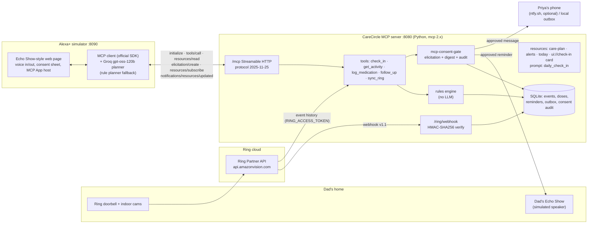

# CareCircle for Alexa+

**"Alexa, is Dad okay today?"** CareCircle is a self-hosted **MCP server** (spec **2025-11-25**, **Streamable HTTP**, official MCP Python SDK) that an Alexa+-style assistant calls to check on an ageing parent who lives alone. It combines **Ring** door, doorbell and motion events with a **medication log**, answers in two spoken sentences with evidence, and **asks before it contacts anyone** through MCP elicitation.

Built for *Build, Ship, Shape: Amazon Developer Hackathon* (Alexa+ track, Open Source mini challenge).

> **Honesty notes.** Alexa+ add-on developer tools (MCP Toolkit, Web Simulator) are partner-only ([hackathon FAQ](https://amazonappdev2026.devpost.com/details/faqs)), so the demo front end is a **simulated Alexa+ experience**: a web page whose backend is a real MCP client. The Ring adapter calls the real Ring Partner API when you supply a Playground token. Without one, it replays an **authored SAMPLE fixture** in the documented API shape, and every SAMPLE event is labelled in the UI and in tool output. People and medications are fictional.


## What it does

| Moment | What happens | MCP feature |
|---|---|---|
| "Alexa, is Dad okay today?" | `check_in` combines today's Ring events and doses into a status (ok / attention / concern), a two-sentence headline and evidence | Structured tool output (`outputSchema`), tool annotations, **MCP Apps** card (`ui://carecircle/check-in.html`) |
| "Yes, remind him and tell Priya" | `follow_up` shows the exact reminder and message and lets the user untick parts. Only approved parts run | **Form elicitation** via [`mcp-consent-gate`](packages/mcp-consent-gate): approval bound to a SHA-256 digest of the action, audit log, one-time code fallback |
| "He just took his BP pill" | `log_medication` matches "blood pressure pill" to Amlodipine and logs the due dose | Idempotent-safe tool, fuzzy matching |
| No movement for 2 h during active hours | The server raises an alert. The Alexa+ client is subscribed and speaks up on its own | `resources/subscribe` → `notifications/resources/updated` (plus `subscriptions/listen` fan-out for 2026-07-28 clients) |
| Ring event arrives | `/ring/webhook` checks Ring's HMAC-SHA256 `X-Signature`, normalizes it, re-evaluates alerts | Ring Partner API webhook v1.1 + `GET /v1/history/devices/{id}/events` polling |

Design rule: **the LLM never decides whether Dad is okay.** Fixed rules in `carecircle/engine.py` do that (overdue dose = attention; no movement for 120 min in active hours, or none by 8:30 am = concern). The model only plans tool calls and phrases the answer.

## Architecture



## Run it (about 2 minutes)

Requirements: Python 3.11+.

```bash
git clone <this repo> carecircle && cd carecircle
python -m venv .venv && source .venv/bin/activate
pip install -r requirements.txt
python scripts/run_demo.py          # MCP server on :8080/mcp, simulator on :8090
```

Open **http://127.0.0.1:8090** and click *"Alexa, is Dad okay today?"* (Chrome also accepts voice: press the mic). The household clock is pinned to **3:10 pm** (`CARECIRCLE_CLOCK=15:10`) so the sample day always shows the same story. Use *Clock +60 min* to trigger the quiet alert. Set `CARECIRCLE_CLOCK=real` for live time.

Optional environment (see `.env.example`):

| Variable | Effect |
|---|---|
| `GROQ_API_KEY` | Groq `openai/gpt-oss-120b` plans tool calls (free tier, falls back to `gpt-oss-20b` on 429). Without it a deterministic rule planner runs the same flow |
| `RING_ACCESS_TOKEN` | Live Ring Partner API (`GET /v1/devices`, `/v1/history/devices/{id}/events`) instead of SAMPLE events. Get a 30-minute token at the [Ring Developer Playground](https://developer.amazon.com/ring/console/playground) |
| `RING_WEBHOOK_SECRET` | HMAC key for `/ring/webhook` (a local demo key is used if unset) |
| `NTFY_TOPIC` | Real push to a phone through [ntfy.sh](https://ntfy.sh) (free, no account). Otherwise messages go to the local outbox |
| `CARECIRCLE_TOKEN` | Require `Authorization: Bearer <token>` on `/mcp` |
| `CARECIRCLE_DB` | SQLite file (default in-memory) |

Run only the server: `python -m carecircle.server`. Run only the simulator against a remote server: `CARECIRCLE_URL=https://your-host python -m alexa_sim.app`.

### Use it from any MCP client

The server is a standard Streamable HTTP MCP endpoint, so any 2025-11-25 client can call it:

```bash
npx @modelcontextprotocol/inspector   # Transport: Streamable HTTP, URL: http://127.0.0.1:8080/mcp
```

Or in code (this is what the simulator does):

```python
from mcp import Client
async with Client("http://127.0.0.1:8080/mcp", mode="legacy", elicitation_callback=ask_user) as c:
    report = (await c.call_tool("check_in", {})).structured_content
```

## Connecting to Alexa+

Per the hackathon FAQ, participants cannot connect a self-hosted MCP server to a real Alexa+ device or console today: the Alexa+ add-on tooling (Category SDK, MCP Toolkit, CLI, Web Simulator) is preview, select partners only. The FAQ accepts a web page acting as a real MCP client. CareCircle is ready for Alexa+ when that opens:

1. **Host it on HTTPS.** Any container host works (`python -m carecircle.server` behind TLS, `HOST=0.0.0.0`). The FAQ notes hosting is not required for judging.
2. **Protect it.** Set `CARECIRCLE_TOKEN` (bearer). An OAuth 2.1 resource server via the SDK's `TokenVerifier` is the next step.
3. **Register the endpoint** `https://<host>/mcp` in the Alexa+ add-on tooling when you get access. The server already sends `instructions` that tell the assistant how to use the tools and when to ask for consent.
4. **Ring account linking.** Replace the Playground token with OAuth account linking (one-way linking from the Ring Appstore). Configure the webhook URL `https://<host>/ring/webhook` and HMAC key in the Ring Developer Portal.

## Tests

```bash
pytest -q                                   # 25 tests: rules, Ring adapter, MCP tools, HTTP transport, webhook, simulator end-to-end
cd packages/mcp-consent-gate && pytest -q   # 12 tests: consent gate
```

Latest run: **25 passed** and **12 passed** (`results/pytest_*.txt`). The end-to-end test starts both servers over real HTTP, asks the simulator, answers the elicitation, logs a dose, advances the clock and checks that the proactive alert arrives through the subscription.

## Repository map

```
carecircle/            MCP server: server.py (tools/resources/routes), engine.py (rules), ring.py (Ring API + webhook),
                       store.py (SQLite), notify.py, models.py (output schemas), ui/check_in_card.html (MCP App)
  fixtures/            care_plan.json (fictional household), ring_sample_events.json (SAMPLE, authored)
alexa_sim/             Alexa+ simulator: agent.py (MCP client + planner), app.py (FastAPI), static/index.html
packages/mcp-consent-gate/   open-source consent layer (MIT), separate pyproject + tests
scripts/run_demo.py    start everything
tests/                 pytest suite
docs/                  PRODUCT_FEEDBACK.md (feedback + friction log)
```

## Limitations (read before judging)

- **Simulated Alexa+ front end**, because the real add-on tooling is partner-only. The MCP traffic is real.
- **Ring data in the demo is SAMPLE** (authored fixture). The live client and webhook code paths are tested against mocks built from the documented shapes. They have not been run against a real Ring account, because the Playground requires an Amazon Developer account the author had not created at build time.
- **Echo reminders are simulated** (shown on the page). Messages to caregivers go to a local outbox unless `NTFY_TOPIC` is set.
- Not a medical device: it reports what sensors and logs say and never gives medical advice.

## License

MIT, see [LICENSE](LICENSE).
